# Apexline 極速對決 🏁

A 3D race against an AI on one screen: **you on the left, the AI on the right**, each seen from behind its own car. The cars can knock into each other (and into the walls). **Ten tracks** to pick from, each its own place: a sunny oval, a sunset coast, mountain hairpins, a figure eight that crosses itself, city blocks, a frozen lake, desert dunes, a night circuit, rain and a long Grand Prix.

<p align="center">
  <a href="https://www.youtube.com/watch?v=dTvia4_5Iaw">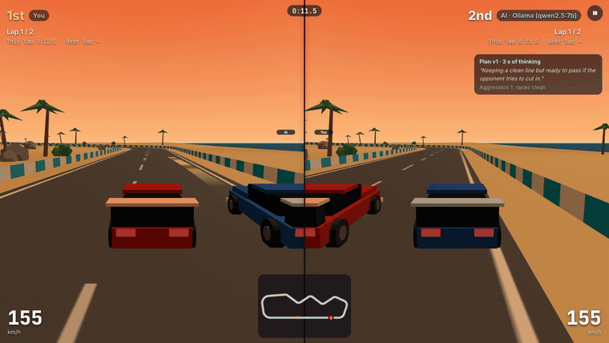</a>
  <br>
  <a href="https://www.youtube.com/watch?v=dTvia4_5Iaw"><b>▶ Watch the 2½-minute film</b></a> (English, recorded live)
</p>

Built with [Reflex](https://reflex.dev/) and [three.js](https://threejs.org/) for the [re-ddns](https://github.com/milochen0418/re_ddns) Agentic App Store. The AI is whatever model the [AI Hub](https://github.com/milochen0418/ai_hub) sets for this app (a local Ollama model such as `qwen3.5:9b`, Claude, …): Apexline holds no model and no key.

## 🤖 How the AI drives

A language model can't steer 120 times a second (a thinking model like `qwen3.5:9b` takes a minute or two to answer), so the AI is **driver and engineer**:

<p align="center">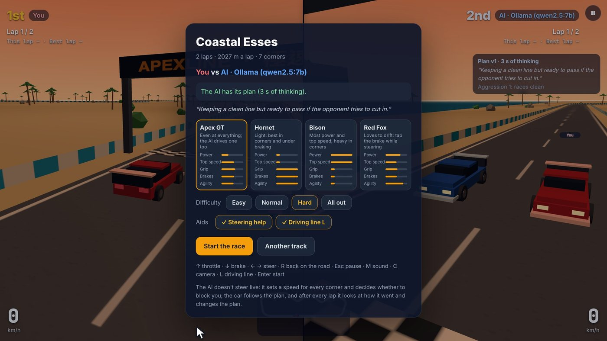</p>

1. **Before the start it studies the track.** It is told every corner (left or right, its angle, the racing line's tightest radius, the grip, the straight before it) and the car's physics in plain words (top speed 200 km/h; the most sideways grip is grip × 18 m/s²). It answers with a speed for every corner and an **aggression** from 0 (keeps well clear of you) to 3 (rams you on purpose). The briefing shows it thinking, second by second; you may start without waiting, and it then drives carefully until its plan comes.
2. **The game drives its car by that plan**: along the racing line, flat out on the straights, braking in time to reach each corner at the planned speed. A plan faster than the grip allows runs wide into the wall and loses time; a timid one loses time too. The right speed is √(grip × 18 × radius).
3. **After every lap it hears how each corner went** (its speed into it, its lowest, how far it ran off the racing line, whether it hit the wall, the gap to you and your lap time) and may change the plan for the next lap.
4. **It remembers each track**: its last plan per model is kept, and it starts from it the next time (or studies the track again if you ask).

The result shows every plan next to what the grip allowed in each corner, so you see how well the model worked it out. In the first tests `qwen3.5:9b` thought 127 s about the Sunny Oval and planned exactly the grip's limit for both turns.

<p align="center">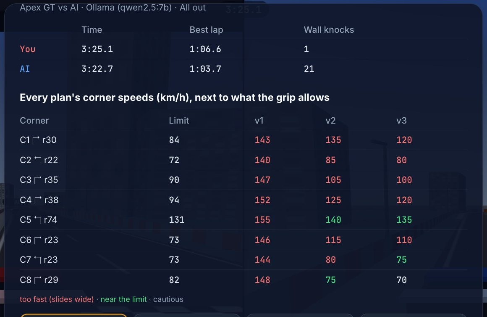</p>

A smaller model gets it wrong, and that is worth watching too. Above, `qwen2.5:7b` on City Blocks, in a race recorded for the film: its first plan took every corner at 140 to 155 km/h where the grip allows 72 to 131, and the car hit the wall again and again. After lap 1 it heard how that went and took C2 down from 140 to 85, C7 from 144 to 80 and C8 from 148 to 75; after lap 2 it brought C7 to 75, close to the limit of 73. Red is too fast, green is near the limit.

## 🗺️ Ten tracks

<table>
  <tr>
    <td width="50%">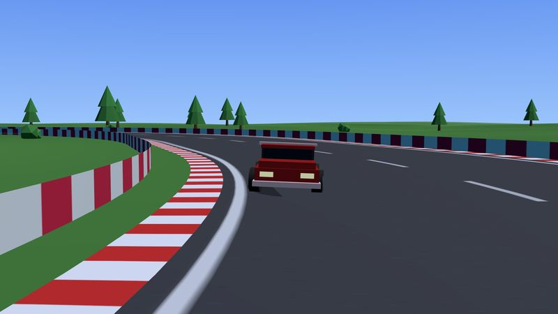<br><b>Sunny Oval</b> · 3 laps · 1308 m · 2 corners<br>Two long straights and two wide turns: get to know the car.</td>
    <td width="50%">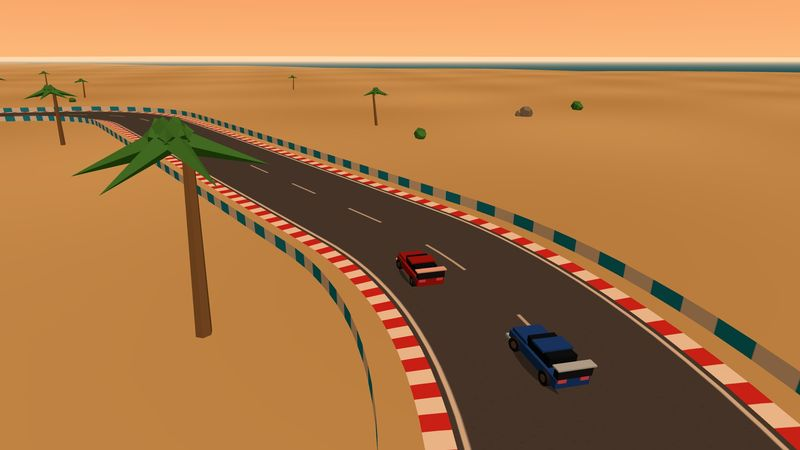<br><b>Coastal Esses</b> · 2 laps · 2027 m · 7 corners<br>A long run by the sea into a string of left-right esses.</td>
  </tr>
  <tr>
    <td width="50%">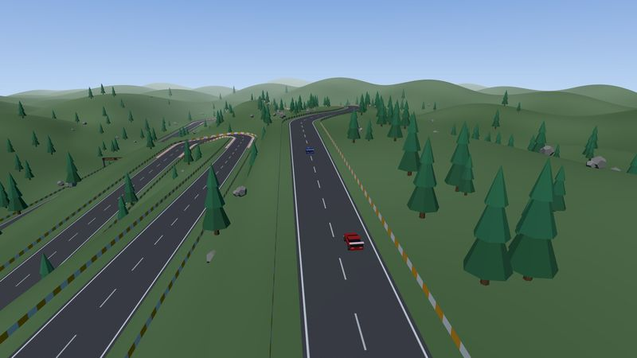<br><b>Hairpin Pass</b> · 2 laps · 2280 m · 4 corners<br>Climb through three hairpins, then race back down the mountain.</td>
    <td width="50%">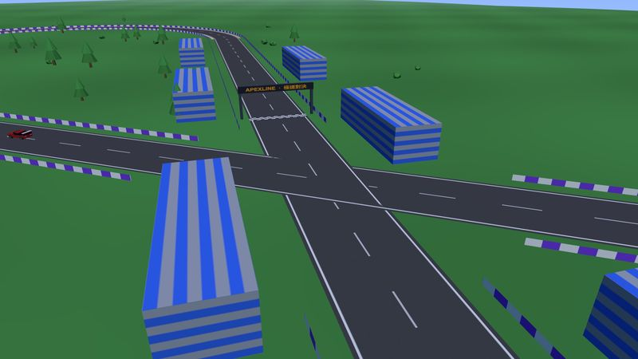<br><b>Figure Eight</b> · 3 laps · 1542 m · 2 corners<br>An eight whose middle is a crossroads: mind the other car there.</td>
  </tr>
  <tr>
    <td width="50%">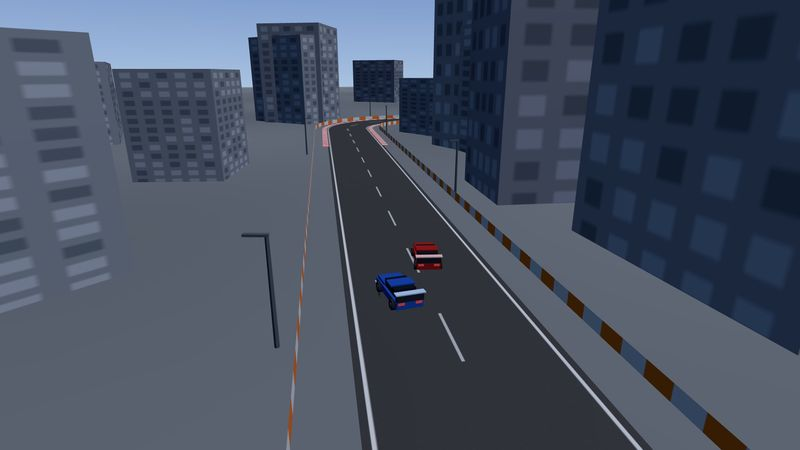<br><b>City Blocks</b> · 3 laps · 1592 m · 8 corners<br>Right-angle turns between the towers and a quick chicane: brake on time.</td>
    <td width="50%">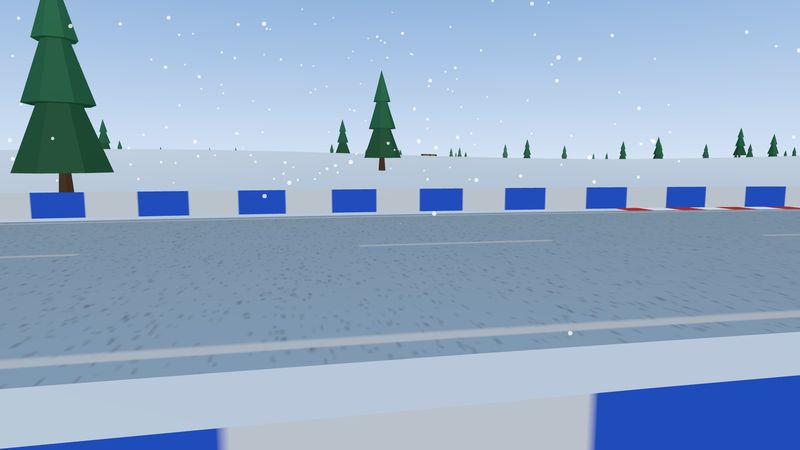<br><b>Frozen Lake</b> · 2 laps · 1939 m · 4 corners<br>Ice under the wheels, less than half the grip; only two stretches of snow bite.</td>
  </tr>
  <tr>
    <td width="50%">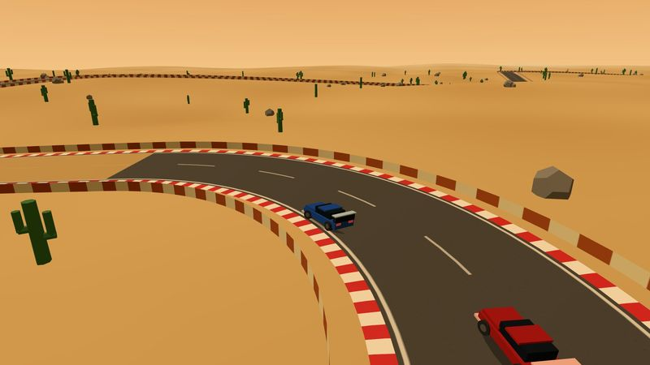<br><b>Desert Dunes</b> · 2 laps · 2183 m · 8 corners<br>Rolling dunes with two stretches of loose sand that steal the grip.</td>
    <td width="50%">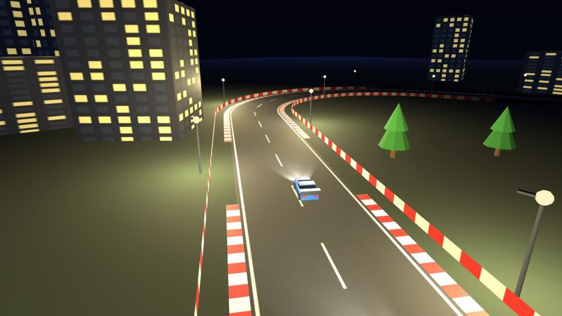<br><b>Night Circuit</b> · 3 laps · 1769 m · 9 corners<br>A twisty circuit lit only by lamps and headlights.</td>
  </tr>
  <tr>
    <td width="50%">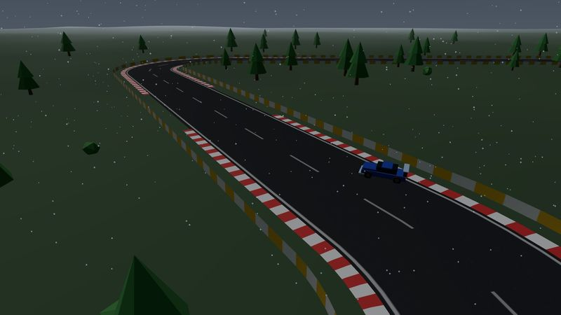<br><b>Rain Ring</b> · 3 laps · 2022 m · 9 corners<br>Rain on the road, slippery everywhere and worse in the puddles.</td>
    <td width="50%">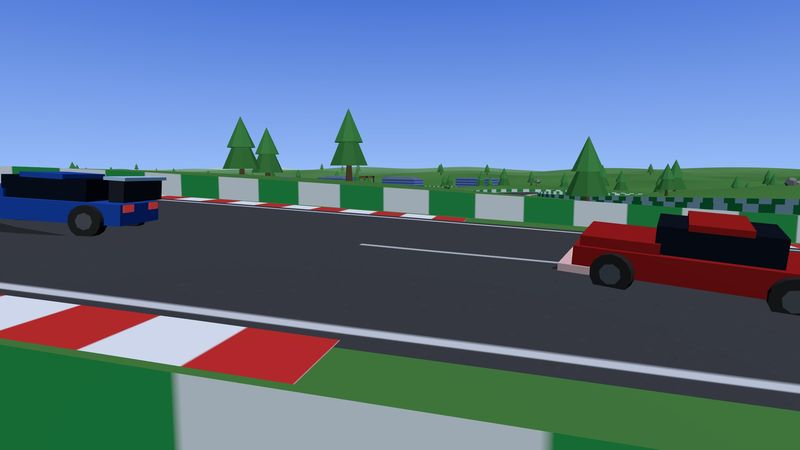<br><b>Grand Prix</b> · 2 laps · 3346 m · 12 corners<br>The longest: a hairpin, esses, fast sweepers, hills, all of it.</td>
  </tr>
</table>

## 🎮 Playing

<p align="center">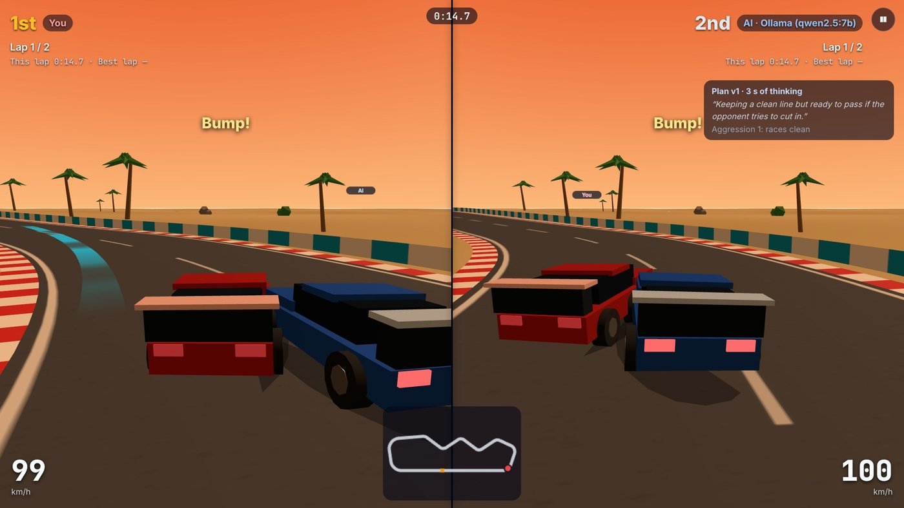</p>

- **↑ / W** throttle, **↓ / S / Space** brake, **← → / A D** steer, **R** back on the road, **Esc / P** pause, **M** sound, **C** camera, **Enter** start. A gamepad works too (left stick, triggers).
- **Your car** (before a race and on the result): Apex GT (even at everything; the AI drives one too), Hornet (light, the best grip and brakes), Bison (the most power and top speed, heavy in corners) or Red Fox (quick, and loves to drift). Over ten tracks they are about level; each has tracks it is best on.

  <p align="center">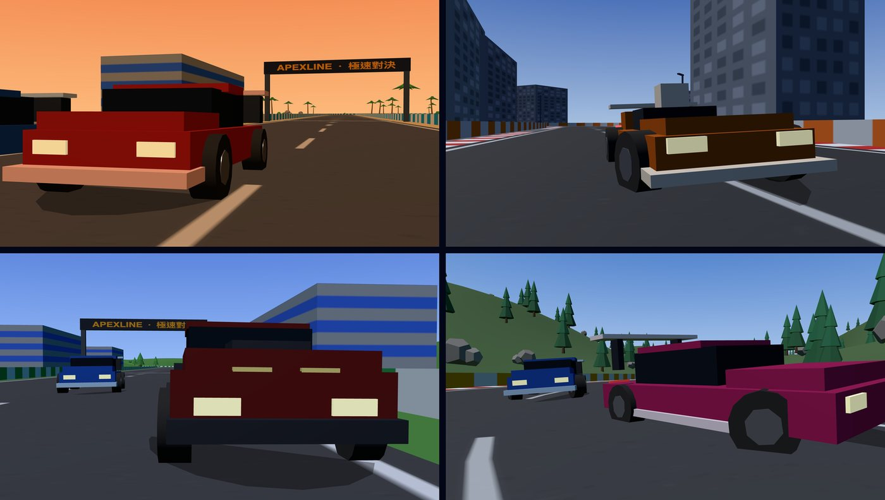</p>

  | Car | Top speed | Acceleration | Braking | Cornering grip |
  | --- | --- | --- | --- | --- |
  | Apex GT | 200 km/h | 9.0 m/s² | 14.0 m/s² | 18.0 m/s² |
  | Hornet | 180 km/h | 8.6 m/s² | 16.1 m/s² | 19.6 m/s² |
  | Bison | 220 km/h | 11.3 m/s² | 12.0 m/s² | 16.0 m/s² |
  | Red Fox | 196 km/h | 10.3 m/s² | 13.7 m/s² | 17.6 m/s² |

- **Difficulty** (same places): Easy, Normal, Hard or All out. The AI drives at 72%, 82%, 92% or 100% of its plan's speeds, and the lower levels hold back its aggression. The model's plan stays the same.
- **Steering help** (on by default): keys are only on or off, so a held key means what the road asks for: a lane change on a straight, the bend's own curve in a bend, the grip's limit in a tight corner. Hold up and a steering key through a corner and the car goes round it, gaining speed until the corner's limit. Near the road's edge the help keeps you on the road. Off, a full key is always the grip's limit. Too fast for a corner, you still have to brake.

  <p align="center">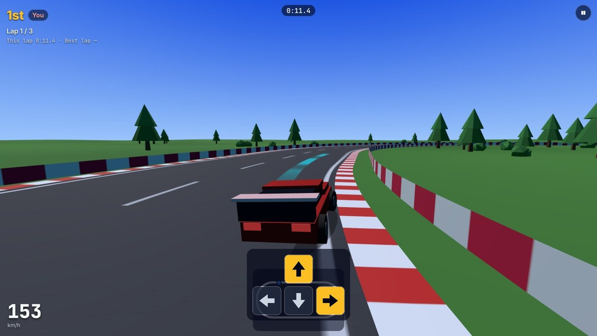</p>

- **Driving line** (L): the racing line on the road ahead, by your speed: cyan is fine, yellow means the brakes are coming, red means brake now.

  <p align="center">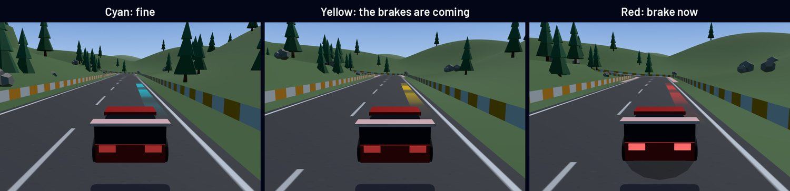</p>

- **Too fast?** The nose still turns in, the car slides wide and the tyres sing and take speed off it. Tap the brake while steering to turn the nose in harder. A scrape along a wall costs little; a real hit costs a lot.
- Places, laps, lap times, speed, the AI's current plan (its version, how long it thought, its note and aggression) and a map are on screen. On a tall screen the two views stack.
- When one car finishes, the other has 25 s to finish too.
- The lobby shows, per track, your best time, the AI's best, your wins and losses against the model, and whether it remembers the track.

<p align="center">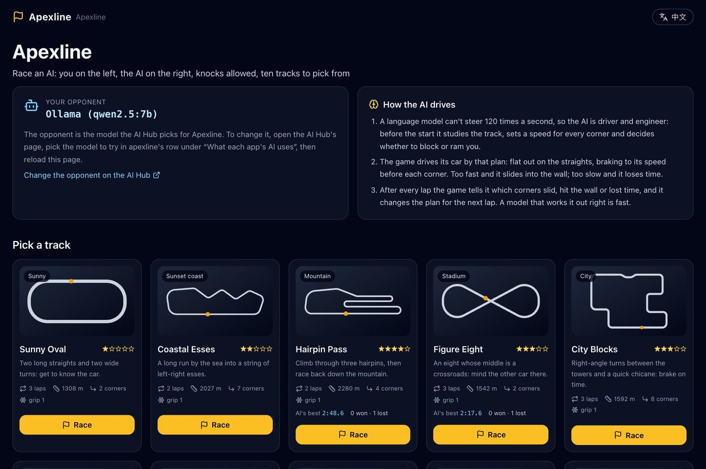</p>

## 🛠️ How it is built

- `apexline/trackgen.py`: the ten tracks as drawings (corners with radii, or smooth curves), made into what the game drives on: the centre line every 2 m with heights, the grip (ice, sand, snow, puddles), the racing line (the line that bends least inside the road), the corners with their limits, and where the road crosses itself. Written once to `apexline/data/tracks/*.json` (`python -m apexline.trackgen`).
- `assets/apexline/`: the game in the browser. `physics.js` (the car: turning, sliding, the steering help, walls, knocks between the cars, laps), `garage.js` (the cars), `driver.js` (the AI's driving by the plan, its level and its lap telemetry), `guide.js` (the driving line), `scenery.js` (ground, road, kerbs, walls, the start gantry, trees, palms, towers, lamps, sea, rain, snow), `cars.js`, `hud.js`, `input.js`, `sound.js` (Web Audio engine), `planner.js` (asking for plans), `game.js` (the race: two views, countdown, finish, result).
- `apexline/strategist.py`: what the model is told (the track, then each lap) and how its plan is read; `apexline/api.py`: `GET /_apexline/track/<id>` and the streamed `POST /_apexline/plan`; `apexline/store.py`: races and remembered plans in `APEXLINE_DATA_DIR` (default `~/.local/share/apexline`).

## 🏎️ Where the handling comes from

- **Tyres that cancel the sideways slide, up to a cap**, so the car goes where it points until the grip runs out: [iforce2d's top-down car](https://www.iforce2d.net/b2dtut/top-down-car). The slide's angle and what it costs: [Car Physics for Games](https://www.asawicki.info/Mirror/Car%20Physics%20for%20Games/Car%20Physics%20for%20Games.html), [carphysics2d](https://github.com/spacejack/carphysics2d).
- **Steering by what the grip can do, not a wheel angle**, because keys don't feel the tyres: [BeamNG Advanced Steering](https://github.com/adam10603/BeamNG-Advanced-Steering), [AC Advanced Gamepad Assist](https://github.com/adam10603/AC-Advanced-Gamepad-Assist); less steering at speed: [Implementing racing games](https://www.gamedeveloper.com/design/implementing-racing-games-an-intro-to-different-approaches-and-their-game-design-trade-offs).
- **Key timing, the nose's extra turn for the eye, and cars as a class's multipliers:** [SuperTuxKart's kart_characteristics.xml](https://github.com/supertuxkart/stk-code/blob/master/data/kart_characteristics.xml).
- **Help only near the edge, and it can be switched off:** Mario Kart's Smart Steering. **The coloured line:** Forza's driving line, in cyan rather than green for players who can't tell red from green.

## 🚀 Running it

**On re-ddns:** install *Apexline* from the App Store (with the AI Hub). Pick the model for `apexline` on the AI Hub's page (*What each app's AI uses*) and open `https://apexline.reflex-ddns.com`.

**Running it on its own** (for development) needs an AI Hub to ask (without one the AI only drives carefully):

```bash
poetry env use python3.15
poetry install
DDNS_AI_HUB_URL=http://127.0.0.1:8172 DDNS_AUTH_SECRET=<the hub's secret> SERVICE_SUBDOMAIN=apexline \
  APEXLINE_DATA_DIR=/tmp/apexline REFLEX_API_URL=http://localhost:8174 \
  poetry run reflex run --frontend-port 3174 --backend-port 8174
```

## 🧪 Tests

```bash
poetry run pytest                      # the tracks, the prompts and plans, the records
node --test tests/js/physics.test.mjs  # the car, the AI's driving: the right plan wins, too fast hits the wall
node tests/js/sim.mjs city,ice_lake    # lap times for plans from 60% to 150% of the limits
poetry run ./run_test_suite.sh smoke_home
DDNS_AI_HUB_URL=… DDNS_AUTH_SECRET=… SERVICE_SUBDOMAIN=apexline poetry run ./run_test_suite.sh race_ai
```

See [testcases/README.md](testcases/README.md).

## 🎬 The film

[The film on YouTube](https://www.youtube.com/watch?v=dTvia4_5Iaw) was recorded live at `https://apexline.reflex-ddns.com` in a real browser, with the app's real model (`qwen2.5:7b` on Ollama): every plan, thinking time and result on screen is what happened. A script drives the red car, and some shots use film cameras added for the video, drawn by the game's own renderer. Narration: Qwen3-TTS (voice Aiden). Music: "Sports Highlights" by Ahjay Stelino, [Mixkit Stock Music Free License](https://mixkit.co/license/#musicFree). Type: Barlow (SIL OFL).

## License

MIT
